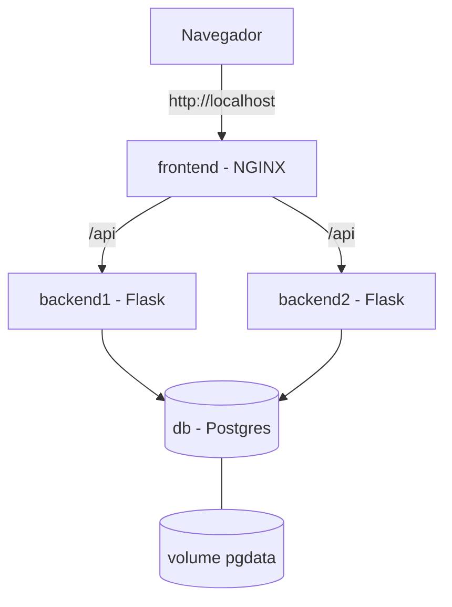
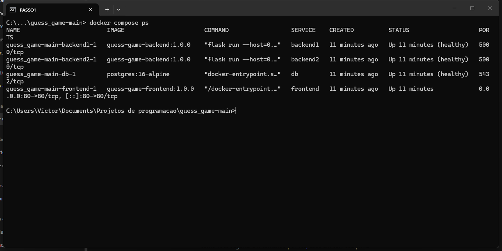
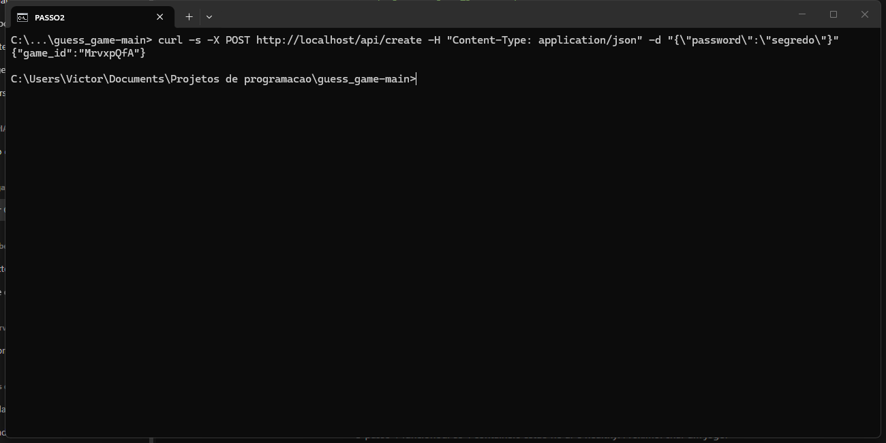
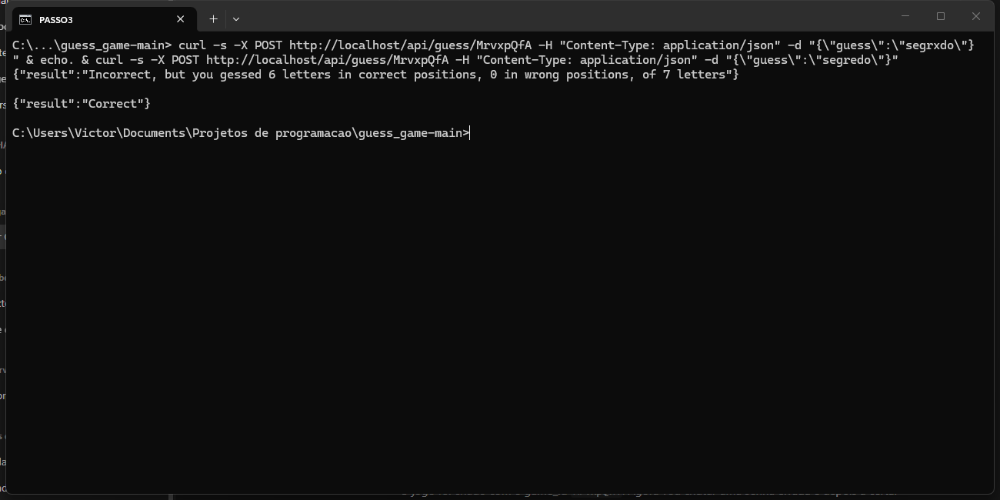
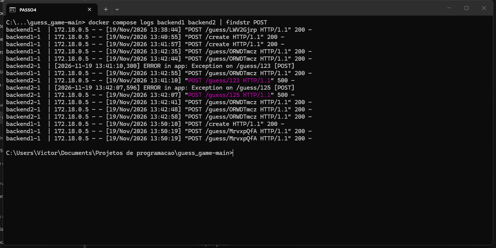
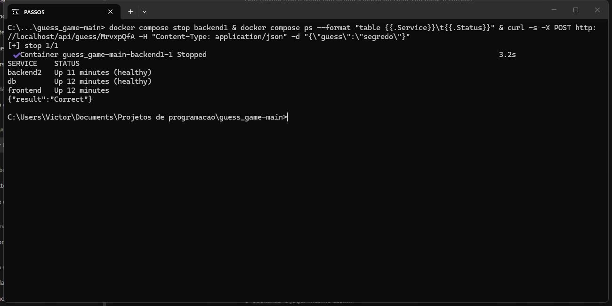
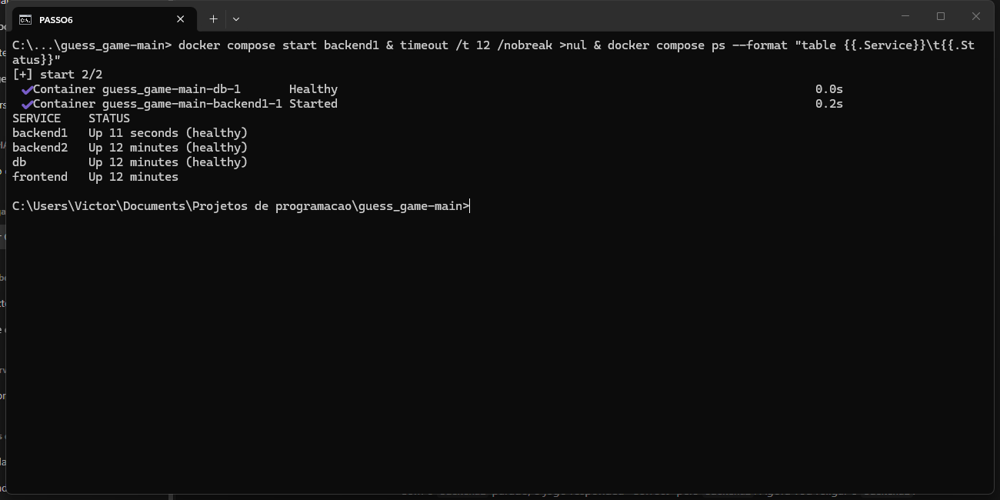
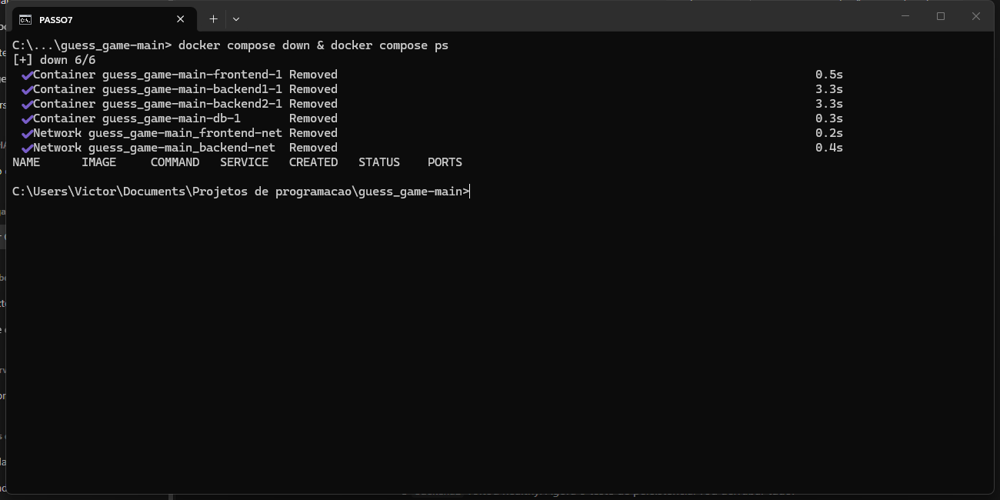
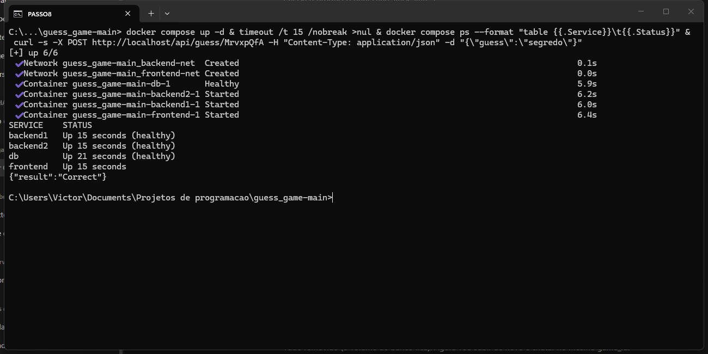

# Guess Game com Docker Compose

Infraestrutura em Docker Compose para o [jogo de adivinhação](https://github.com/fams/guess_game):
backend Flask (2 instâncias), banco Postgres com volume persistente e NGINX como proxy reverso
com balanceamento de carga, servindo também o frontend React.

> O código das aplicações **não foi alterado**. As instruções originais do jogo estão em [README-jogo.md](README-jogo.md).

## URL de acesso

Depois do `docker compose up`, acesse: **http://localhost**

(Se a porta 80 estiver ocupada, troque `HTTP_PORT` no `.env`, por exemplo `HTTP_PORT=8080` → http://localhost:8080)

## Arquitetura



O navegador só fala com o NGINX. Ele entrega o React em `/` e repassa o que chega em `/api` para os dois backends, que gravam no Postgres.

## Estrutura dos arquivos adicionados

| Arquivo | Função |
|---|---|
| `docker-compose.yml` | Define e orquestra os serviços, volume e redes |
| `.env` | Versões das imagens, credenciais do banco e porta exposta |
| `Dockerfile.backend` | Imagem do backend Flask (Python 3.12) |
| `Dockerfile.frontend` | Build multi-stage: Node 18.17 compila o React, NGINX serve o resultado |
| `nginx/default.conf` | Proxy reverso + balanceamento de carga entre backends |
| `.dockerignore` | Evita enviar `node_modules`, `.venv` etc. para o build |

## Decisões de design

### Serviços
- **db** – imagem oficial `postgres`. Possui `healthcheck` (`pg_isready`); os backends só sobem quando o banco está pronto (`depends_on: condition: service_healthy`), porque o backend conecta no banco já na inicialização.
- **backend1 / backend2** – a mesma imagem do backend, definida uma única vez com uma âncora YAML (`x-backend`). Configurado via variáveis `FLASK_DB_*` (as mesmas do `start-backend.sh` original), com `FLASK_DB_HOST=db`.
- **frontend** – NGINX contendo o build do React. É o único serviço com porta publicada no host.

### Integração frontend ↔ backend
O React usa `REACT_APP_BACKEND_URL` para montar as URLs (`/create`, `/guess/<id>`). Na build ela recebe o valor relativo `/api`, então o navegador chama `http://localhost/api/create`, e o NGINX remove o prefixo `/api` e repassa para `backend:/create`. Tudo fica na mesma origem: sem CORS e sem expor os backends.

### Balanceamento de carga
- Bloco `upstream backend` com `backend1` e `backend2`, estratégia **round-robin** (padrão do NGINX), adequada porque o backend é stateless (o estado fica no Postgres).
- `max_fails=3 fail_timeout=10s`: uma instância com falha sai temporariamente do pool.
- `proxy_next_upstream error timeout http_502 http_503 http_504`: se uma instância cair no meio de uma requisição, ela é refeita na outra. O usuário não percebe a queda de um backend.

Optei por dois serviços nomeados em vez de `deploy.replicas`, pois o NGINX resolve os nomes do upstream na inicialização; com nomes fixos o pool fica explícito e cada instância pode ser reiniciada/inspecionada separadamente.

### Volumes
- Volume nomeado **`pgdata`** montado em `/var/lib/postgresql/data`. Os dados sobrevivem a `docker compose down`, à recriação do container e à troca de versão da imagem. Só são apagados com `docker compose down -v`.

### Redes
- **backend-net**: db, backend1, backend2 e frontend (NGINX precisa alcançar os backends).
- **frontend-net**: rede do NGINX, por onde a porta publicada é exposta.
- O Postgres e os backends **não publicam portas** no host; o único ponto de entrada é o NGINX.

### Resiliência
- Todos os serviços usam `restart: unless-stopped`: se um container falhar (ou o Docker reiniciar), ele é reiniciado automaticamente.
- Healthchecks no Postgres e no backend (`/health`).
- Com 2 backends + `proxy_next_upstream`, a queda de um backend não derruba o jogo.

## Instalação e execução

Pré-requisitos: Docker e Docker Compose v2.

```bash
git clone <url-deste-repositorio>
cd <pasta-do-repositorio>
docker compose up -d --build
```

Acesse **http://localhost**.

Comandos úteis:

```bash
docker compose ps                 # status (healthy) dos serviços
docker compose logs -f backend1   # logs de um serviço
docker compose down               # para tudo (mantém os dados)
docker compose down -v            # para tudo e APAGA o volume do banco
```

### Como jogar
1. Em http://localhost, crie um jogo digitando a senha secreta e guarde o `game_id`.
2. Vá em *Breaker*, informe o `game_id` e tente adivinhar.

### Testando a API pelo proxy

```bash
curl -X POST http://localhost/api/create -H "Content-Type: application/json" -d '{"password":"segredo"}'
curl -X POST http://localhost/api/guess/<game_id> -H "Content-Type: application/json" -d '{"guess":"segredo"}'
```

### Testando a resiliência

```bash
# Derruba um backend: o jogo continua funcionando pelo outro
docker compose stop backend1
# ... jogue normalmente ...
docker compose start backend1

# Simula uma falha (o processo do Flask morre): o Docker reinicia o container sozinho
docker compose exec backend2 python -c "import os,signal; os.kill(1, signal.SIGINT)"
docker inspect -f '{{.RestartCount}} {{.State.Status}}' $(docker compose ps -q backend2)
# RestartCount aumenta e o status volta a "running"
# (obs.: `docker compose stop/kill` é parada manual, e o Docker não reinicia nesse caso)
```

### Testando a persistência

```bash
docker compose down
docker compose up -d
# o game_id criado antes continua válido
```

## Evidências de funcionamento

Testes executados no `cmd`, na pasta do projeto, um comando por vez.

**1. Containers no ar:** os 4 serviços estão rodando, com banco e backends `healthy`.



**2. Criação de jogo pelo proxy:** `POST /api/create` devolve o `game_id` (`MrvxpQfA`).



**3. Chutes:** com a senha errada, o jogo informa quantas letras acertou; com a certa, responde `Correct`.



**4. Balanceamento de carga:** os logs mostram requisições atendidas tanto pelo `backend1` quanto pelo `backend2`.



**5. Falha de um backend:** com o `backend1` parado, o jogo continua respondendo `Correct`, atendido pelo `backend2`.



**6. Recuperação:** o `backend1` é religado e volta a ficar `healthy`.



**7. Derrubando tudo:** `docker compose down` remove containers e redes; o volume do banco é mantido.



**8. Persistência:** depois de subir tudo de novo, o mesmo `game_id` criado antes continua válido (`Correct`), pois os dados ficaram no volume `pgdata`.



## Atualização dos componentes

Cada componente tem sua versão no arquivo **`.env`**. Atualizar é só trocar a versão e recriar o serviço; o Compose recria apenas o que mudou.

```env
BACKEND_VERSION=1.0.0
FRONTEND_VERSION=1.0.0
POSTGRES_VERSION=16-alpine
```

### Backend
Após alterar o código (ou para lançar uma nova versão):
```bash
# no .env: BACKEND_VERSION=1.1.0
docker compose up -d --build backend1 backend2
```
Para atualizar sem indisponibilidade, atualize um de cada vez (o NGINX direciona para o que estiver no ar):
```bash
docker compose up -d --build --no-deps backend1
docker compose up -d --no-deps backend2
```
Se a imagem estiver publicada em um registry, basta trocar `image:` / a tag e rodar `docker compose pull && docker compose up -d`.

### Frontend (e configuração do NGINX)
```bash
# no .env: FRONTEND_VERSION=1.1.0
docker compose up -d --build frontend
```

### Banco de dados
```bash
# no .env: POSTGRES_VERSION=16.4-alpine
docker compose pull db
docker compose up -d db
```
Os dados ficam no volume `pgdata` e são preservados. Atualizações de *minor* (16.x → 16.y) são diretas. Para *major* (ex.: 16 → 17), o formato dos dados muda: faça um dump antes e restaure na versão nova:
```bash
docker compose exec db pg_dumpall -U postgres > backup.sql
# troca POSTGRES_VERSION, docker compose down, remove o volume e sobe de novo
cat backup.sql | docker compose exec -T db psql -U postgres
```

### Voltar versão (rollback)
Basta voltar o valor no `.env` para a tag anterior e rodar `docker compose up -d`; a imagem anterior continua no cache local.
